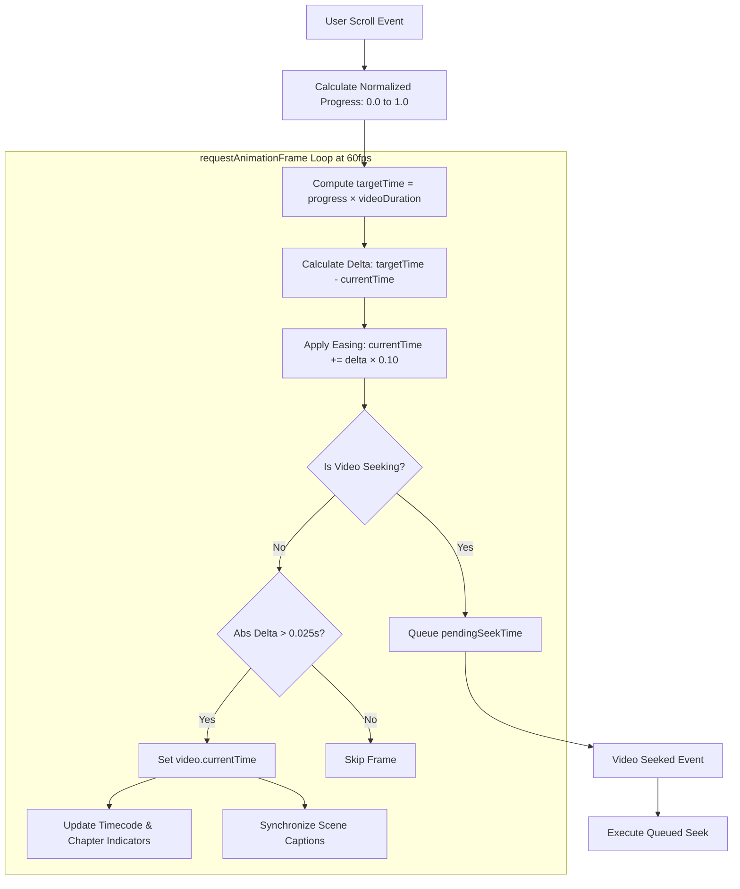
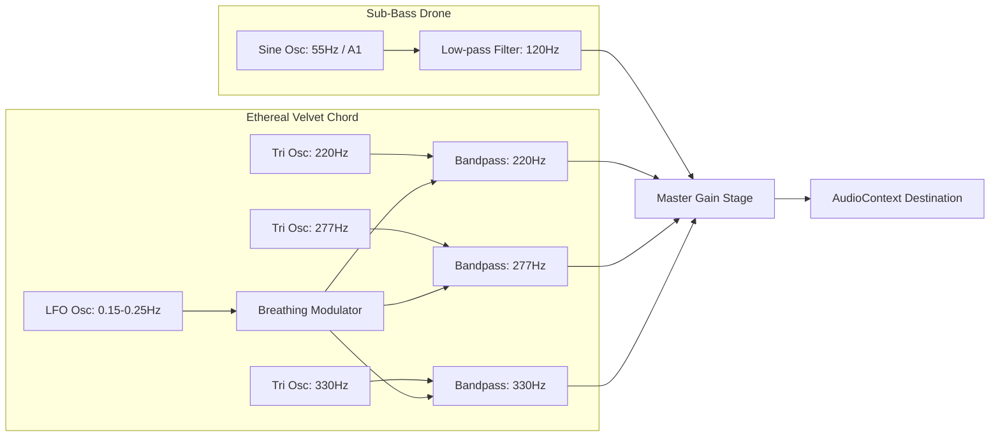

# AUREN — High Luxury Editorial Experience

> *“Classic roots. Modern attitude.”*

[](#prerequisites)
[-blue.svg)](#technology-stack)
[](#atmospheric-web-audio-soundscape)
[](#license)

A cinematic haute-couture digital exhibition that synthesizes classical Renaissance sculpture with contemporary metropolitan streetwear. The experience opens with an editorial garden sanctuary that fluidly transitions into a scroll-controlled first-person video tour, moving through Italian estate salons, gallery colonnades, and modern bistros.

---

## Preview


---

## Table of Contents

- [Project Overview](#project-overview)
- [Key Features](#key-features)
  - [Scroll-Controlled Video Scrubber](#scroll-controlled-video-scrubber)
  - [Pinned Diagonal Card Deck](#pinned-diagonal-card-deck)
  - [Expanding 9:16 Statue Monolith](#expanding-916-statue-monolith)
  - [Subtle Cursor-Following Parallax](#subtle-cursor-following-parallax)
  - [Atmospheric Web Audio Soundscape](#atmospheric-web-audio-soundscape)
  - [Accessibility & Reduced Motion](#accessibility--reduced-motion)
  - [Quick View Modal & VIP Salon](#quick-view-modal--vip-salon)
- [Technology Stack](#technology-stack)
- [Project Structure](#project-structure)
- [Prerequisites](#prerequisites)
- [Installation & Quick Start](#installation--quick-start)
- [Environment Configuration](#environment-configuration)
- [Running Locally](#running-locally)
  - [Using the Included HTTP Streaming Server (Recommended)](#using-the-included-http-streaming-server-recommended)
  - [Alternative Static Servers](#alternative-static-servers)
- [Build Instructions](#build-instructions)
- [Architecture & Technical Implementation](#architecture--technical-implementation)
  - [Video Scrubbing Physics & Seek Debouncing](#video-scrubbing-physics--seek-debouncing)
  - [HTTP 206 Partial Content Requirement](#http-206-partial-content-requirement)
  - [Procedural Audio Synthesis Graph](#procedural-audio-synthesis-graph)
  - [Diagonal Kinematics Engine](#diagonal-kinematics-engine)
- [Testing & Quality Verification](#testing--quality-verification)
- [Deployment Guide](#deployment-guide)
- [Troubleshooting](#troubleshooting)
- [Contributing](#contributing)
- [License](#license)
- [Acknowledgments](#acknowledgments)

---

## Project Overview

**AUREN** explores an aesthetic tension: dressing ancient Roman and Florentine marble masterpieces in oversized tailoring, lacquered amber calfskin, shaggy shearling overcoats, and modern headphones.

Built without heavy frameworks or bloated dependencies, the project demonstrates how vanilla web technologies (HTML5, CSS3, JavaScript, and the Web Audio API) can deliver a 60fps editorial experience rivaling native applications.

---

## Key Features

### Scroll-Controlled Video Scrubber
- **Pinned Stage Architecture**: A `480vh` scroll track pins the viewport, mapping scroll depth directly to video playback progress forward and backward.
- **Momentum Physics Interpolation**: Uses a `requestAnimationFrame` render loop with eased delta interpolation (`ease = 0.10`), imparting physical weight that continues briefly when scrolling pauses and settles naturally without snapping.
- **Seamless Poster Handoff**: Starts with a high-resolution still (`images/A1(2).png`) aligned precisely to the video's first frame, fading out across the initial 7% of scroll to reveal active video scrubbing beneath.
- **Synchronized Scene Narratives**: Editorial captions appear and dissolve dynamically at key journey milestones away from on-screen sculptures:
  - **Scene 01 // The Estate** (7.5s – 12.5s): *“Enter the world of AUREN”*
  - **Scene 02 // The Gallery** (13.5s – 18.0s): *“Heritage, reimagined”*
  - **Scene 03 // The Bistro** (19.0s – 24.0s): *“Everyday, elevated”*
  - **Scene 04 // The Colonnade** (25.0s – 29.2s): *“Made to be remembered”*
  - **Scene 05 // The Compendium** (29.8s – 32.4s): *“Explore the Collection”*
- **Interactive Timeline HUD**: Real-time elapsed timecode (`MM:SS / MM:SS`), scrub progress bar, and clickable chapter dots that scroll smoothly to specific scenes.

### Pinned Diagonal Card Deck
- **5 Bespoke Runway Ensembles**:
  - `Look 01`: *The Rose Sovereign Tuxedo* (€3,450)
  - `Look 02`: *The Tangerine Palazzo Suit* (€2,850)
  - `Look 03`: *The Shaggy Cloud Overcoat* (€3,100)
  - `Look 04`: *The Emerald Salon Velvet* (€2,950)
  - `Look 05`: *The Imperial Caesar Robe* (€4,600)
- **Diagonal Kinematic Trajectory**: Cards enter from the bottom right (`+44vw`, `+28vh`, tilt angle `+6°`), glide smoothly into focus at stage center, and exit toward the top left with a subtle reverse tilt and opacity falloff.
- **Fully Responsive & Reversible**: Zero horizontal scrollbar, touch-safe, with bidirectional scrub synchronization and dot selector HUD.

### Expanding 9:16 Statue Monolith
- Section titled *“The Art of Being Seen”*.
- Starts as a centered 9:16 portrait card with rounded corners (`22px`) on a warm cream canvas (`#F7F3EA`), bordered by 4 minimalist editorial corner labels.
- As the user scrolls through the pinned section:
  1. Corner labels fade and gently blur (`0px` to `12px`).
  2. The card smoothly expands to fill `100vw × 100vh` (16:9 full viewport ratio) without image distortion.
  3. Corner radii transition from `22px` to `0px`.
  4. Editorial copy, a cinematic scrim gradient, and an exploration button fade into view with subtle drop shadows.

### Subtle Cursor-Following Parallax
- Multi-layer optical depth reacting to desktop cursor coordinates (`[-1.0, 1.0]`) with buttery LERP easing (`factor = 0.075`).
- Independent layers prevent mouse movements from conflicting with scroll-driven scrubbing:
  - **Hero Stage**: Parallax canvas translates opposite mouse vector (±18px X, ±14px Y).
  - **Product Cards**: 3D perspective tilt (`perspective(900px) rotateX(±2.2deg) rotateY(±2.5deg)`) and inner image glide (±10px X, ±8px Y).
  - **Expanding Monolith & Philosophy Images**: Restrained optical shifts inside clipped containers.
- Automatically disabled on touch screens and under reduced-motion mode; recenters smoothly when the pointer leaves the browser window.

### Atmospheric Web Audio Soundscape
- **Procedural Synthesizer**: Requires no external audio files or bandwidth.
- **Bespoke Harmonic Composition**:
  - Sub-bass drone: `55 Hz` (A1) sine oscillator routed through a `120 Hz` low-pass filter.
  - Ethereal velvet chord: Triangle oscillators tuned to `220 Hz` (A3), `277.18 Hz` (C#4), and `329.63 Hz` (E4) passing through tuned bandpass filters (`Q = 3.0`).
  - Breathing dynamics: Low Frequency Oscillators (LFOs: `0.15 Hz` – `0.25 Hz`) gently modulating chord amplitudes.
  - Master gain stage: Exponential volume ramping over `2.5s` upon activation and `1.2s` upon muting.
- Animated equalizer bar indicator in the header navigation.

### Accessibility & Reduced Motion
- System preference detection via `prefers-reduced-motion: reduce`.
- Manual motion toggle in the navigation (`MOTION: CINEMATIC` ⇄ `MOTION: REDUCED`).
- In reduced-motion mode:
  - Parallax and scroll-coupled video scrubbing are paused.
  - A dedicated HUD control panel emerges offering video playback (`Play Journey`), previous scene (`← Prev Scene`), and next scene (`Next Scene →`) keyframe jumping.

### Quick View Modal & VIP Salon
- **Runway Quick View**: Interactive modal displaying full piece descriptions, high-resolution photography, size selection (`S`, `M`, `L`, `XL`), and simulated piece allocation requests.
- **VIP Atelier Invitation Form**: Private salon dispatch form with interactive feedback states.

---

## Technology Stack

| Layer | Technology | Description |
| :--- | :--- | :--- |
| **Markup** | HTML5 Semantic | Accessible structure, ARIA landmarks, SEO meta tags |
| **Styling** | Vanilla CSS3 | Custom properties, clamp scaling, glassmorphism, 3D transforms |
| **Typography** | Google Fonts | `Cinzel` (display), `Cormorant Garamond` (editorial), `Plus Jakarta Sans` (interface) |
| **Scripting** | Vanilla JavaScript (ES6+) | RAF animation loop, LERP interpolation, scroll math, event delegation |
| **Audio** | Web Audio API | Client-side procedural harmonic synthesis (oscillators, biquad filters, LFOs) |
| **Media** | HTML5 `<video>` & `` | H.264 MP4 with optimized keyframe intervals, responsive high-res PNG/JPG |
| **Server** | Node.js Built-in (`http`, `fs`, `path`) | Lightweight zero-dependency server supporting HTTP 206 Partial Content byte ranges |

---

## Project Structure

```text
Auren/
├── index.html              # Main HTML5 document with complete editorial markup & sections
├── styles.css              # Editorial design system, typography tokens, glassmorphism, responsive rules
├── script.js               # Application logic: RAF physics loop, video scrubbing, audio synth, parallax
├── serve.js                # Custom Node.js HTTP server supporting HTTP 206 Partial Content byte ranges
├── package.json            # Project manifest defining npm scripts (start, dev)
├── .gitignore              # Git ignore rules for OS files, IDE caches, and diagnostic outputs
│
├── images/                 # Active website imagery
│   ├── 1.jpg to 5.jpg      # Featured runway lookbook cards (Looks 01 through 05)
│   ├── 7.jpg               # Expanding Apollo statue monolith ("The art of being seen")
│   ├── A1(2).png           # Hero opening garden sanctuary poster (matches video frame 0)
│   ├── AAAs.png            # Classical Apollo in blush tailoring & headphones (Philosophy section)
│   └── ...                 # Additional concept and source assets
│
├── videos/                 # Optimized video assets for scroll scrubbing
│   ├── 0925_optimized.mp4  # Primary AVC/H.264 web-optimized video stream
│   └── 0925(3).mp4         # High-resolution fallback source
│
└── aurum-main/             # Project archive & calibration reference files
    ├── Frame 257 (7).png   # High-resolution visual preview screenshot (10.4 MB)
    ├── Prompt-aurum.pdf    # Original creative and technical specification document
    ├── README.md           # Archive summary note
    ├── scene_checks/       # 12 milestone frame extractions used during choreography calibration
    └── scene_checks_detail/# 33 second-by-second frame captures (sec_00 through sec_32)
```

---

## Prerequisites

To run AUREN locally:
- **Node.js**: Version `18.0.0` or higher (verified with Node.js `v24.14.1`).
- **Web Browser**: Any modern evergreen browser supporting ES6, HTML5 Video, and the Web Audio API:
  - Google Chrome / Chromium 80+
  - Apple Safari 14.1+
  - Mozilla Firefox 80+
  - Microsoft Edge 80+

> [!NOTE]
> No package installation (`npm install`) is required because the project uses zero third-party npm packages.

---

## Installation & Quick Start

1. **Clone the repository**:
   ```bash
   git clone https://github.com/your-username/auren.git
   cd auren
   ```

2. **Verify files exist**:
   Ensure `index.html`, `script.js`, `styles.css`, `serve.js`, `images/`, and `videos/` are present in the project root.

3. **Launch the application**:
   ```bash
   npm start
   ```
   *Or execute directly with Node:*
   ```bash
   node serve.js
   ```

4. **Open in browser**:
   Navigate to [http://127.0.0.1:3000/](http://127.0.0.1:3000/).

---

## Environment Configuration

AUREN is an entirely self-contained client-side application.
- **No external API keys or secrets are required.**
- **No database connections are needed.**
- **No `.env` file is required.**

All procedural audio is generated in real time on the client's device using the browser's audio synthesizer.

---

## Running Locally

### Using the Included HTTP Streaming Server (Recommended)

Run:
```bash
npm start
```
*Output:*
```text
AUREN Luxury Server running at http://127.0.0.1:3000/
```

#### Why use `serve.js` instead of standard static servers?
Modern web browsers (particularly Safari and Chromium-based engines) require **HTTP 206 Partial Content (`Range: bytes=start-end`)** headers to seek through video streams frame-by-frame during scroll events.
Opening the project via `file:///` or through simple static servers that only send `HTTP 200 OK` can cause video frame freezes, buffer thrashing, or high latency. `serve.js` provides full HTTP 206 byte-range streaming out of the box with zero npm dependencies.

### Alternative Static Servers

If you prefer using other local servers, ensure they support HTTP byte-range requests:

```bash
# Python 3 (Python's built-in server supports range requests in modern releases)
python -m http.server 3000

# Using npx serve (install not required)
npx -y serve -l 3000 .

# Using VS Code Live Server extension
# Right-click index.html -> "Open with Live Server"
```

---

## Build Instructions

Because AUREN is written in standards-compliant vanilla HTML5, CSS3, and modern JavaScript:
- **No build step is required.**
- **No Webpack, Vite, or Babel compilation is necessary.**
- The source files are ready for production deployment directly.

---

## Architecture & Technical Implementation

### Video Scrubbing Physics & Seek Debouncing



To eliminate frame jitter and browser seek thrashing:
1. Scroll events calculate a target timestamp (`targetTime`).
2. The `requestAnimationFrame` loop steps `currentTime` toward `targetTime` with a momentum coefficient (`ease = 0.10`).
3. If the video decoder is already in a `seeking` state, new timestamps are queued into `pendingSeekTime` and dispatched only when `seeked` fires.
4. Updates with deltas under `0.025s` are skipped to conserve GPU and battery resources.

### HTTP 206 Partial Content Requirement

In `serve.js`, requests containing a `Range` header receive partial slices:
```javascript
res.writeHead(206, {
  'Content-Range': `bytes ${start}-${end}/${totalSize}`,
  'Accept-Ranges': 'bytes',
  'Content-Length': (end - start) + 1,
  'Content-Type': 'video/mp4'
});
```
This enables the browser to request small 500KB–2MB chunks on demand rather than buffering the entire 29MB video file upfront.

### Procedural Audio Synthesis Graph



### Diagonal Kinematics Engine

The 5 runway lookbook cards move through a 2.5D coordinate space according to normalized section progress `u`:
- **Displacement Vector**: `X = -u * 44vw`, `Y = -u * 28vh`
- **Dynamic Rotation**: `tilt = -u * 6.0 deg`
- **Dynamic Z-Index**: `zIndex = round(50 - abs(u) * 20)`
- **Asymmetric Opacity Ramp**: Smooth entrance from bottom right (`u` between `-1.0` and `-0.25`), centered hold at `u = 0`, and early exit fade before card touches the stage headline.

---

## Testing & Quality Verification

The codebase has undergone the following verifications:

| Test / Check | Tool / Method | Result | Notes |
| :--- | :--- | :--- | :--- |
| **Node.js Server Execution** | `node -c serve.js` | PASSED | Syntax valid |
| **Client Script Validation** | `node -c script.js` | PASSED | Syntax valid (ES6+) |
| **Server HTTP Response** | `Invoke-WebRequest http://127.0.0.1:3000/` | HTTP 200 OK | Delivers `index.html` with headers |
| **Byte-Range Streaming Test** | HTTP HEAD request on `/videos/0925_optimized.mp4` | PASSED | Returns `Accept-Ranges: bytes` |
| **Asset Reference Integrity** | Path cross-check across `index.html`, `script.js`, `styles.css` | 100% MATCH | All 10 referenced images and 2 videos exist |
| **Secrets & Credentials Scan** | Regex search for keys/tokens/passwords | ZERO FOUND | No secrets or private data |
| **Prefers-Reduced-Motion** | CSS `@media (prefers-reduced-motion)` & JS `matchMedia` | VERIFIED | Switches UI to accessible mode |

---

## Deployment Guide

AUREN can be deployed to any static web hosting platform or container environment.

### 1. Static Edge Hosting (Vercel, Netlify, Cloudflare Pages)

Since AUREN requires no build step:
- **Build Command**: *(leave empty)*
- **Output Directory**: `.` (root directory)

#### Notes on Video Streaming at the Edge
Platforms like Vercel, Netlify, and Cloudflare Pages automatically support HTTP 206 byte-range requests for static media files stored in the repository.

### 2. GitHub Pages
1. Push your repository to GitHub.
2. In your repository settings, navigate to **Pages**.
3. Under **Build and deployment**, select **Source**: `Deploy from a branch` (e.g., `main` branch, `/ (root)` folder).
4. Save and allow the GitHub Actions workflow to publish.

> [!TIP]
> **Git LFS Recommendation**: If you track high-resolution raw video assets exceeding 50 MB in Git history, consider tracking them using [Git LFS](https://git-lfs.github.com/):
> ```bash
> git lfs install
> git lfs track "*.mp4"
> git add .gitattributes
> ```

### 3. Docker / Node.js Container

Create a minimal `Dockerfile`:
```dockerfile
FROM node:20-alpine
WORKDIR /app
COPY . .
EXPOSE 3000
CMD ["node", "serve.js"]
```
Build and run:
```bash
docker build -t auren-experience .
docker run -p 3000:3000 auren-experience
```

---

## Troubleshooting

### Video does not scrub smoothly or freezes
- **Cause**: The project was opened directly in a browser via `file:///index.html` instead of an HTTP server. Browsers restrict byte-range seeking on local file protocols.
- **Solution**: Run `npm start` or `node serve.js` and visit [http://127.0.0.1:3000/](http://127.0.0.1:3000/).

### Sound does not play when clicking the sound toggle
- **Cause**: Modern web browsers enforce autoplay policies that suspend `AudioContext` until explicit user interaction.
- **Solution**: The soundscape is muted by default. Clicking the `SOUND OFF` button in the header initializes and resumes the audio context. Ensure your browser tab is not muted and system audio is active.

### Parallax or video scrub feels disabled
- **Cause**: Your operating system or browser has **Reduced Motion** enabled, or the in-app toggle was clicked.
- **Solution**: Click the `MOTION: REDUCED` button in the navigation to toggle back to `MOTION: CINEMATIC`, or use the reduced-motion keyframe controls (`Next Scene →`).

---

## Contributing

Contributions that preserve the editorial aesthetic and performance standards are welcome:

1. Fork the repository.
2. Create your feature branch:
   ```bash
   git checkout -b feature/editorial-enhancement
   ```
3. Test your changes locally using `node serve.js`.
4. Ensure zero external dependencies are introduced unless strictly necessary.
5. Commit your changes:
   ```bash
   git commit -m "feat: enhance runway diagonal kinematics"
   ```
6. Push to the branch:
   ```bash
   git push origin feature/editorial-enhancement
   ```
7. Open a Pull Request.

---

## License

This project's code and assets are currently **unspecified / proprietary**. All rights to the creative concepts, photography, video choreography, and typography layout are reserved.

If you plan to open-source this project under an MIT, Apache 2.0, or CC-BY license, please update this section and add a `LICENSE` file.

---

## Acknowledgments & Design Credits

- **Creative Direction**: Inspired by classical Florentine and Roman Renaissance marble sculptures juxtaposed with contemporary high-fashion streetwear.
- **Typography**: [Cinzel](https://fonts.google.com/specimen/Cinzel), [Cormorant Garamond](https://fonts.google.com/specimen/Cormorant+Garamond), and [Plus Jakarta Sans](https://fonts.google.com/specimen/Plus+Jakarta+Sans) via Google Fonts.
- **Audio Architecture**: Procedural ambient soundscape synthesized using the Web Audio API.
